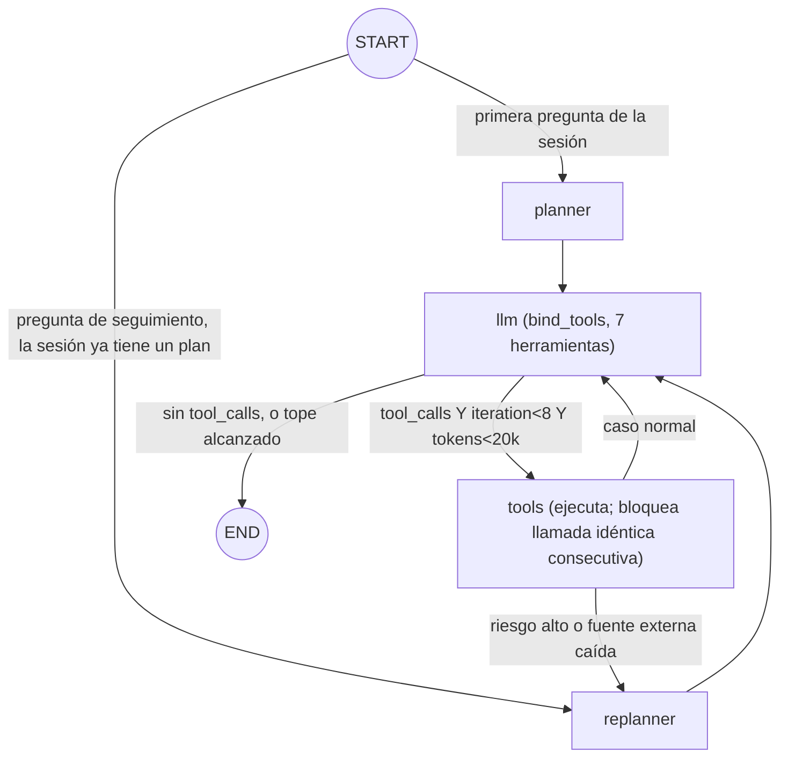

# RAG_Finanzas — Agente RAG de Auditoría Financiera (EP1 + EP2 - ISY0101)

Proyecto académico de la Evaluación Parcial N°1 de **Ingeniería de Soluciones
con IA (ISY0101)**: un agente basado en LLM + RAG para apoyar al Departamento
de Auditoría Interna y Cumplimiento Tributario de una institución financiera
en la revisión de facturas electrónicas, notas de crédito, estados de
resultados, balances trimestrales e informes de riesgo.

## Problema que resuelve

- **Alucinaciones en montos/RUT**: guardrails explícitos + esquema Pydantic
  estricto + verificación fáctica posterior a la generación.
- **Ruido en la recuperación RAG**: un paso de LLM-as-a-judge filtra chunks
  irrelevantes antes de que lleguen al generador.
- **Falta de trazabilidad**: cada chunk lleva metadatos (`source`, `page`,
  `fecha_ingesta`, `tipo_documento`, `chunk_id`) y cada respuesta debe citar
  el fragmento textual exacto que la respalda.
- **Latencia y costo de tokens**: un callback (`AuditCallbackHandler`)
  registra latencia, tokens y costo estimado de cada llamada al LLM.
- **Fuentes de datos internas y externas** (`src/external_data.py`): además
  del índice FAISS sobre `data/raw/` (fuente interna), el pipeline consulta
  en vivo la API pública **mindicador.cl** (UF, dólar, UTM del día) como
  fuente externa, para resolver preguntas que requieren convertir montos en
  UF/USD a CLP. Si la fuente externa falla (timeout, caída), el pipeline
  degrada con gracia y sigue respondiendo solo con la fuente interna — ver
  evidencia de un caso real de esto en
  [`docs/evidencia_pruebas.md`](docs/evidencia_pruebas.md).
- **Preguntas de seguimiento sin perder precisión** (`src/memory.py`): el
  pipeline mantiene memoria conversacional por sesión (`session_id`), para
  resolver referencias como "esa misma factura" sin que el guardrail
  anti-alucinación se relaje — ver
  [Memoria conversacional](#memoria-conversacional-ie4) más abajo.

Ver [`docs/architecture.md`](docs/architecture.md) (con imagen renderizada
en [`docs/architecture.png`](docs/architecture.png)) para el diagrama de
arquitectura completo y la justificación de decisiones, y
[`docs/caso_organizacional.md`](docs/caso_organizacional.md) para la
descripción formal de la organización, objetivos medibles, datos y
restricciones del caso.

> **EP2**: sobre este pipeline RAG se construyó un **agente funcional**
> (`src/agent/`) que decide por sí mismo qué herramienta usar y en qué
> orden, con planificación priorizada, replanificación y memoria de largo
> plazo entre sesiones. Ver la sección
> [Agente funcional (EP2)](#agente-funcional-ep2) más abajo.

## Estructura del repositorio

```
README.md
requirements.txt
.env.example
conftest.py
data/raw/                    # Documentos fuente (4 ejemplos sintéticos: factura,
                              # nota de crédito, informe de riesgo, contrato en UF)
data/processed/               # Artefactos intermedios (vacío, generado en ejecución)
vectorstore/                  # Índice FAISS persistido (generado, no versionado)
notebooks/                     # Notebook de demo end-to-end
src/
  config.py                    # Conexión a LLM (Groq / Google / GitHub) y embeddings (local / Google / GitHub)
  loaders.py                    # Ingesta, chunking, construcción del índice FAISS (fuente INTERNA)
  external_data.py               # Fuente EXTERNA: API mindicador.cl (UF/dólar/UTM), degrada con gracia
  memory.py                       # Memoria conversacional de sesión (IE4): BufferMemory / SummaryMemory
  prompts.py                       # Plantillas EP1: rol experto, few-shot, CoT, guardrails XML
  rag_pipeline.py                   # Ensamblado LCEL (EP1): retriever | judge | fuente externa | memoria | prompt | LLM | parser
  metrics.py                         # Callback de costo/latencia + 4 métricas RAG + esquemas Pydantic
  fact_checking.py                    # Cadena secundaria de verificación fáctica (EP1)
  agent/                                # Agente funcional (EP2) — ver sección "Agente funcional (EP2)"
    chunk_store.py                       # Almacén de chunks por ejecución (evita retipear texto por IDs)
    informe_store.py                      # Almacén de InformeAuditoria por ejecución (idem, vía informe_id)
    case_store.py                          # CaseLog (JSONL, dedup) + FindingsIndex (FAISS, memoria de largo plazo)
    approval.py                             # Aprobación de hallazgos pendientes (NO es una herramienta del LLM)
    plan.py                                  # PlanAuditoria/PasoPlan: plan priorizado (Pydantic)
    llm_utils.py                              # Reintento acotado ante respuesta vacía del LLM
    tools.py                                   # Las 7 herramientas atómicas + AgentDependencies
    graph.py                                    # Grafo LangGraph: planner/llm/tools/replanner
tests/
  test_*.py                            # Suite automática determinista (pytest, sin costo de API)
  test_agent_*.py                       # Suite determinista del agente EP2 (herramientas, grafo, plan, memoria)
  test_agent_*_live.py                   # Pruebas EP2 contra Groq real (marcador `live`, ver más abajo)
  manual_benchmark_groq.py              # Benchmark MANUAL contra Groq real (evidencia de pruebas, EP1)
  manual_benchmark_memoria.py            # Benchmark MANUAL comparativo buffer vs summary (EP1)
docs/
  caso_organizacional.md                 # Organización, objetivos medibles, datos, restricciones (IE1)
  architecture.md / .mmd / .png           # Diagrama de arquitectura EP1 (fuente Mermaid + imagen renderizada, IE7)
  boceto_interfaz.svg / .png               # Boceto conceptual de la interfaz de consulta del auditor
  evidencia_pruebas.md                      # Evidencia de corridas reales: EP1 y, en progreso, los escenarios EP2
  comparacion_memoria.md                     # Comparación empírica BufferMemory vs SummaryMemory (IE4/IE8)
```

## Instalación

Requiere **Python 3.11+**.

```bash
python -m venv venv
# Windows (PowerShell)
venv\Scripts\Activate.ps1
# Linux/Mac
source venv/bin/activate

pip install -r requirements.txt
```

## Variables de entorno

Copia `.env.example` a `.env` y completa tu clave de Groq:

```bash
cp .env.example .env
```

| Variable | Requerida | Descripción |
|---|---|---|
| `GROQ_API_KEY` | Sí (proveedor de chat activo por defecto: `groq`) | Clave de [Groq Console](https://console.groq.com/keys). |
| `LLM_PROVIDER` | No (default `groq`) | `groq`, `google` o `github` — proveedor de **chat**, ver abajo. |
| `GROQ_CHAT_MODEL` | No (default `openai/gpt-oss-120b`) | Modelo de generación servido por Groq. |
| `EMBEDDING_PROVIDER` | No (default `local`) | `local`, `google` o `github` — proveedor de **embeddings**, independiente del de chat. |
| `LOCAL_EMBEDDING_MODEL` | No (default `sentence-transformers/all-MiniLM-L6-v2`) | Modelo de embeddings local (CPU, sin API). |
| `GOOGLE_API_KEY` / `GOOGLE_CHAT_MODEL` / `GOOGLE_EMBEDDING_MODEL` | Solo si usas `google` en `LLM_PROVIDER` o `EMBEDDING_PROVIDER` | Ver justificación abajo. |
| `TEMPERATURE` | No (default `0.0`) | Determinismo exigido para un dominio de auditoría. |
| `CHUNK_SIZE` / `CHUNK_OVERLAP` | No (default `1200`/`200`) | Ver justificación en `src/loaders.py`. |
| `RETRIEVER_K` | No (default `8`) | Top-k de chunks recuperados antes del filtro LLM-judge. |
| `JUDGE_MIN_SCORE` | No (default `6.0`) | Umbral (0-10) para que un chunk pase el filtro del juez. |
| `MEMORY_STRATEGY` | No (default `buffer`) | `buffer` o `summary` — estrategia de memoria conversacional, ver [Memoria conversacional](#memoria-conversacional-ie4). |

**Nunca subas tu `.env` real al repositorio** (`.gitignore` ya lo excluye).

### Sobre los proveedores de LLM/embeddings

El proveedor de **chat** y el de **embeddings** se configuran por separado
(`LLM_PROVIDER` / `EMBEDDING_PROVIDER`), porque no todos los proveedores
ofrecen ambas capacidades:

- **Chat activo por defecto: Groq** (`LLM_PROVIDER=groq`). Tres razones
  concretas para esta elección:
  1. **Costo**: la corrida real de pruebas documentada en
     [`docs/evidencia_pruebas.md`](docs/evidencia_pruebas.md) costó
     ≈$0,0085 USD por ~30 llamadas (25 preguntas de auditoría completas +
     reintentos) — economía suficiente para iterar sin preocuparse por
     cuota durante el desarrollo y las pruebas de este proyecto.
  2. **Sin bloqueo de facturación**: el proyecto de Google Cloud asociado a
     la cuenta usada originalmente quedó bloqueado con
     `403 PERMISSION_DENIED: Your project has been denied access`
     independientemente del modelo invocado (ver nota de vigencia abajo);
     Groq no exige tarjeta de crédito ni facturación habilitada para su
     tier gratuito.
  3. **Compatibilidad con el patrón OpenAI del propio curso**: el endpoint
     de Groq es compatible con la API de OpenAI (mismo formato de
     `chat.completions`), el mismo patrón que ya usa GitHub Models en los
     notebooks de la asignatura — cambiar entre ambos es trivial y no
     introduce un SDK nuevo que aprender.
  El modelo, `openai/gpt-oss-120b`, es además un modelo "razonador" de
  pesos abiertos servido por Groq — encaja con el diseño Chain-of-Thought
  del prompt de auditoría.
- **Embeddings activos por defecto: locales** (`EMBEDDING_PROVIDER=local`),
  vía `sentence-transformers` (`all-MiniLM-L6-v2`) corriendo en CPU, **no
  Gemini**. Dos razones: (a) **Groq no ofrece API de embeddings**, así que
  de todas formas se necesitaba un segundo proveedor solo para esa etapa; y
  (b) al generar los embeddings, esa etapa NO depende de ninguna API de
  pago ni cuota — corre en CPU, sin el riesgo de bloqueo de cuenta que sí
  afectó a Google (punto 2 arriba). **Matiz importante:** "local" no
  significa "sin red" en sentido estricto — la PRIMERA vez que se usa
  `all-MiniLM-L6-v2` en una máquina, `sentence-transformers` descarga los
  pesos del modelo (~90 MB) desde Hugging Face Hub (requiere internet esa
  vez; verás `Warning: You are sending unauthenticated requests to the HF
  Hub` — no bloquea nada, es solo informativo, opcionalmente se evita
  configurando `HF_TOKEN`). Las ejecuciones siguientes sí son 100% offline
  (el modelo queda cacheado localmente). Las llamadas de red reales y
  recurrentes del proyecto son: **Groq** (todas las preguntas al agente) y
  **mindicador.cl** (fuente externa, UF/dólar/UTM) — ambas documentadas y
  con degradación con gracia si fallan.
- **Google AI Studio/Gemini** (el proveedor que exige explícitamente el
  enunciado del EP1, con `text-embedding-004` + Gemini) **se mantiene
  disponible e íntegro** en `src/config.py` para uso futuro: basta con
  `LLM_PROVIDER=google` y/o `EMBEDDING_PROVIDER=google` en `.env`.
- **GitHub Models** (patrón usado en los notebooks de clase) también sigue
  disponible como alternativa para chat y embeddings.

Toda la lógica de conexión vive aislada en `src/config.py`
(`get_chat_model()` / `get_embeddings()`), de modo que cambiar de proveedor
es solo una variable de entorno, nunca una reescritura de código.

> **Nota de vigencia (importante para la entrega):** durante el desarrollo,
> varios nombres de modelo que en algún momento parecían vigentes dejaron
> de estarlo: en Google, `text-embedding-004`, `gemini-1.5-flash` y luego
> `gemini-2.5-flash`; en Groq, `llama-3.3-70b-versatile`. En ambos casos se
> verificó el catálogo real invocando la API directamente antes de fijar un
> nombre en el código (`client.models.list()` para Google vía SDK
> `google-genai`; `GET /openai/v1/models` + una llamada real a
> `/chat/completions` para Groq, ya que `/models` puede listar modelos sin
> acceso real de inferencia para la cuenta). Vale la pena mencionar esto en
> el informe como parte de las "limitaciones del modelo utilizado" (IL1.4).
>
> Además, si alguna vez usas el proveedor `google` y obtienes
> `403 PERMISSION_DENIED: Your project has been denied access` con
> CUALQUIER modelo, no es un problema de nombre de modelo: es un bloqueo a
> nivel del proyecto de Google Cloud/AI Studio asociado a esa
> `GOOGLE_API_KEY` (posibles causas: falta de facturación habilitada, el
> proyecto quedó marcado/suspendido, o restricciones propias de la cuenta).
> La solución no es de código: genera una API key nueva desde un proyecto
> distinto, revisa el estado de facturación/cuota en Google Cloud Console,
> o contacta al soporte de Google como indica el mensaje de error. Por eso
> el proveedor de chat activo por defecto en este proyecto es Groq.

## Cómo correr el pipeline

1. **Construir el índice** a partir de `data/raw/` (incluye 4 documentos
   sintéticos de ejemplo: una factura, una nota de crédito con alerta de
   duplicidad, un informe de riesgo con estado de resultados, y un contrato
   de arriendo en UF para probar la fuente externa):

   ```bash
   python -m src.loaders
   ```

2. **Consultar el agente**:

   ```bash
   python -m src.rag_pipeline
   ```

   O de forma programática:

   ```python
   from src.rag_pipeline import AuditRagPipeline

   pipeline = AuditRagPipeline()
   resultado = pipeline.run("¿Existen señales de riesgo de fraude en la nota de crédito NC-045?")
   print(resultado.informe.model_dump_json(indent=2))
   print(resultado.callback.summary())
   ```

3. **Notebook de demo end-to-end**: `notebooks/demo_pipeline.ipynb` recorre
   ingesta -> consulta -> fact-checking -> métricas.

4. **Benchmark manual con evidencia de consumo de API** (gasta cuota real
   de Groq, no lo corre `pytest` automáticamente):

   ```bash
   python tests/manual_benchmark_groq.py
   ```

   Corre 5 preguntas reales (incluyendo el caso guardrail de un documento
   inexistente y una conversión UF→CLP vía la fuente externa) y resume
   llamadas/tokens/costo/latencia. El resultado de la última corrida está
   documentado en [`docs/evidencia_pruebas.md`](docs/evidencia_pruebas.md).

## Cómo correr los tests

```bash
pytest -v
```

Los tests están divididos según su dependencia de credenciales:

- `tests/test_loaders.py`, `tests/test_metrics.py`, `tests/test_prompts.py`,
  `tests/test_benchmark.py`, `tests/test_external_data.py`: **deterministas,
  no requieren ninguna API key ni llamadas de red reales** (ni siquiera de
  embeddings: `load_raw_documents`/`split_documents` no llaman a ningún
  proveedor; `test_external_data.py` mockea `requests.get` por completo).
  `test_benchmark.py` valida, con Exact Match y RegEx, la extracción de RUT
  y montos CLP contra `tests/ground_truth.json` sobre los documentos reales
  de `data/raw/`.
- Construir el índice FAISS (`python -m src.loaders`) usa embeddings
  **locales** por defecto: no requiere ninguna API key.
- La ejecución completa del pipeline contra el LLM real (`src/rag_pipeline.py`
  ejecutado como script, `tests/manual_benchmark_groq.py`, o las celdas del
  notebook que llaman al modelo) **sí requiere** `GROQ_API_KEY` configurada
  (o `GOOGLE_API_KEY`/`GITHUB_TOKEN` si cambias `LLM_PROVIDER`). La fuente
  externa (`mindicador.cl`) no requiere ninguna API key, pero sí acceso a
  internet; si no está disponible, el pipeline degrada con gracia (ver
  `docs/evidencia_pruebas.md` para un caso real de esto).

## Métricas de evaluación RAG

`src/metrics.py` implementa las 4 métricas oficiales del curso de forma
determinista (sin dependencia de RAGAS/LangSmith), pero con nombres y firmas
compatibles para facilitar una futura migración:

- **Context Precision**: `|recuperados ∩ relevantes| / |recuperados|`.
- **Context Recall**: `|recuperados ∩ relevantes| / |relevantes|`.
- **Faithfulness**: proporción de afirmaciones `[Soportado]` según
  `fact_checking.py`.
- **Answer Relevancy**: proxy léxico (similitud coseno TF) entre pregunta y
  respuesta — ver nota de diseño en `src/metrics.py` sobre cómo reemplazarlo
  por una implementación basada en embeddings reales.

## Memoria conversacional (IE4)

El pipeline soporta preguntas de seguimiento dentro de una misma sesión
(`session_id`), p.ej. "¿Cuál es el RUT de F-1023?" seguido de "¿Y cuál era
el RUT de esa misma factura otra vez?". `src/memory.py` implementa dos
estrategias intercambiables vía `MEMORY_STRATEGY`:

- **`buffer`** (default): guarda cada turno (pregunta + respuesta) tal
  cual. Sin llamadas LLM extra, sin pérdida de precisión, pero el contexto
  crece con la conversación.
- **`summary`**: mantiene un resumen progresivo, actualizado con una
  llamada extra al LLM (Groq) por turno. Contexto casi constante en
  tamaño, con el riesgo de que el resumen pierda precisión de cifras
  exactas al comprimir.

El historial se inyecta como texto ANTES de la pregunta actual — al JUEZ y
al GENERADOR (ambos basados en LLM), pero **no** al retriever (para no
diluir el embedding de búsqueda) — sin una llamada extra de reformulación
de pregunta ("history-aware retriever"), por ser más simple y confiable
dado que ya existen guardrails anti-alucinación estrictos. El prompt deja
explícito que el historial solo sirve para resolver referencias
ambiguas, nunca como fuente del dato reportado (ver `src/prompts.py`).

```python
from src.rag_pipeline import AuditRagPipeline

pipeline = AuditRagPipeline()  # usa MEMORY_STRATEGY de .env
pipeline.run("¿Cuál es el RUT del emisor en la factura F-1023?", session_id="sesion-1")
pipeline.run("¿Y cuál era el RUT de esa misma factura otra vez?", session_id="sesion-1")
```

**Comparación empírica (buffer vs summary)**, corrida real contra Groq de
la misma conversación de 5 turnos con una pregunta de seguimiento: ambas
estrategias respondieron el dato de seguimiento correctamente (sin
degradación observada), pero `summary` costó **16,2% más** ($0,010206 USD
vs $0,008783 USD) y usó **5 llamadas extra** a la API — la llamada
adicional de actualización del resumen superó, a esta escala, el ahorro de
tokens de comprimir el historial. Ver
[`docs/comparacion_memoria.md`](docs/comparacion_memoria.md) para la tabla
completa, el detalle por turno y la conclusión (llena el requisito de
"pruebas comparativas de hiperparámetros" de IE8).

## Agente funcional (EP2)

Sobre el pipeline RAG de la EP1 (que sigue intacto y funcionando igual,
`src/rag_pipeline.py` no se modificó) se construyó un **agente funcional**
en `src/agent/` que integra las mismas capacidades (consulta a los
documentos internos, fuente externa, generación del informe, verificación
fáctica) como **herramientas atómicas**, y es el **LLM quien decide**, en
cada paso, cuál usar y en qué orden — no una cadena con pasos fijos como en
la EP1.

### Arquitectura: el grafo decide, no está cableado



Implementado con **LangGraph** (`src/agent/graph.py`). El estado del grafo
(`AgentState`) persiste entre turnos de una misma sesión vía un
checkpointer (`MemorySaver`, en memoria del proceso); cada turno reinicia
el tope de iteraciones/tokens y la guarda de repetición, pero conserva el
historial de mensajes y el plan vigente.

### Las 7 herramientas atómicas (`src/agent/tools.py`)

| Herramienta | Tipo | Envuelve |
|---|---|---|
| `recuperar_documentos` | consulta | FAISS (fuente interna, EP1) |
| `juzgar_relevancia` | razonamiento | LLM-as-judge (EP1) |
| `consultar_tipo_cambio` | consulta externa | `mindicador.cl` (EP1) |
| `generar_informe` | razonamiento | Prompt auditor + parser Pydantic (EP1); máximo una vez por pregunta, valida en código |
| `verificar_afirmaciones` | razonamiento | Fact-checking (EP1); recibe un `informe_id`, nunca el JSON completo |
| `buscar_hallazgos_previos` | consulta (memoria de largo plazo) | Índice FAISS de hallazgos **aprobados**, separado del de documentos |
| `registrar_hallazgo` | **escritura** | Log de casos (JSONL, con deduplicación); único riesgo alto queda `pendiente_de_aprobación` |

Los chunks y los informes generados **nunca viajan como texto por los
argumentos del LLM**: viven en `ChunkStore`/`InformeStore` (por ejecución)
y las herramientas se pasan IDs, no el contenido — evita que el modelo
retipee (y potencialmente altere) una cita textual, y ahorra tokens.

Ninguna herramienta lanza una excepción hacia el grafo: los errores (fuente
externa caída, IDs inexistentes, respuesta vacía del LLM tras reintentos)
se devuelven como observación (`{"error": "..."}`) para que el agente
pueda razonar sobre ellos y decidir un siguiente paso.

### Memoria: corto plazo vs. largo plazo

- **Corto plazo** (de sesión): el historial de mensajes del propio grafo
  (vía el checkpointer), no `src.memory` — eso sigue siendo exclusivo de
  `AuditRagPipeline` (EP1), para no duplicar el historial en el prompt.
- **Largo plazo** (`case_store.FindingsIndex`): un índice FAISS **separado**
  del de documentos, que solo indexa hallazgos **aprobados**, persistido en
  disco (`vectorstore_hallazgos/`, ignorado por git) y recargable tras un
  reinicio del proceso. Se consulta explícitamente con
  `buscar_hallazgos_previos`, y es lo que permite que una pregunta en una
  sesión **nueva** (sin historial de corto plazo) recupere un hallazgo
  registrado en una sesión anterior.
- La aprobación de un hallazgo (`src/agent/approval.py`) es una función
  separada, deliberadamente **fuera** de la lista de herramientas del LLM:
  el agente nunca puede auto-aprobarse un hallazgo de riesgo alto.

### Plan priorizado y replanificación (`src/agent/plan.py`)

El agente genera un plan priorizado antes de actuar, inyectado como mensaje
en la conversación (no solo en un campo interno) para que realmente pese en
la siguiente decisión. Se replanifica -incrementando la versión del plan-
ante 3 disparadores concretos, verificables en código:

1. Un hallazgo de riesgo **alto** (`registrar_hallazgo` -> pendiente de
   aprobación).
2. Una fuente externa que deja de estar disponible a mitad de tarea
   (`disponible=False`).
3. Un mensaje de seguimiento del usuario en una sesión que **ya tenía** un
   plan (no es la primera pregunta de esa sesión).

### Instalación y variables de entorno

Las mismas que la EP1 (ver arriba) — `langgraph` ya está en
`requirements.txt`, no se necesita ninguna variable de entorno adicional.
Opcional: `AUTO_APPROVE_HALLAZGOS=true` en `.env` para pruebas donde
quieras aprobar hallazgos automáticamente en vez de llamar
`src.agent.approval.aprobar_hallazgo` a mano.

### Demo interactiva (`python -m src.agent.graph`)

Punto de entrada pensado tanto para la presentación en vivo como para que
cualquier evaluador pruebe el agente sin tocar código ni leer los tests:

```bash
python -m src.loaders          # una vez: construye el índice FAISS de data/raw/
python -m src.agent.graph       # requiere GROQ_API_KEY en .env
```

Al ejecutarlo:

1. Pide un **ID de sesión** (Enter genera uno nuevo; reutilizar el mismo ID
   en una corrida posterior continúa esa sesión — útil para probar
   replanificación por mensaje de seguimiento).
2. En cada turno, deja elegir un **escenario documentado** (consulta
   simple, factura en UF, riesgo alto, documento inexistente, fuente
   externa caída -forzada a propósito para la demo-, memoria de largo
   plazo) o **escribir cualquier pregunta libre**.
3. Imprime, para cada turno: la traza Pensamiento → Acción → Observación
   (herramienta por herramienta), el **plan vigente y su versión**, y
   **tokens/costo/latencia reales de ESE turno** (vía
   `src/agent/token_tracker.py` — cifras medidas en el momento, nunca
   inventadas). Al salir (`salir`/Enter vacío), muestra el resumen total
   de la sesión.

No requiere editar ningún archivo: todo (sesión, escenario/pregunta, salir)
se elige por teclado en tiempo de ejecución.

> Dos escenarios documentados en `docs/evidencia_pruebas.md` -evidencia
> contradictoria e inyección de instrucciones- no están en el menú de esta
> demo porque usan documentos sintéticos que no forman parte del corpus
> real de `data/raw/`; se ejecutan con `pytest tests/test_agent_graph_live.py -k "contradictoria or inyeccion" -m live`.

### Cómo correr los tests del agente

```bash
pytest tests/test_agent_*.py -v
```

Deterministas (LLM/retriever/embeddings simulados), **sin gastar API**: las
herramientas una por una (caso feliz + caso de error), el grafo (secuencia
no cableada, tope de iteraciones/tokens, guarda de repetición), el plan y
sus 3 disparadores de replanificación, y el escenario completo de memoria
de largo plazo entre sesiones (con persistencia real en disco vía
`tmp_path`, no mock).

### Cómo correr las pruebas `live` (contra Groq real)

Las pruebas que llaman al modelo real están marcadas `@pytest.mark.live` y
**se excluyen por defecto** (`pytest.ini`: `addopts = -m "not live"`), para
que la suite normal nunca gaste cuota de API:

```bash
pytest -m live -v -s          # requiere GROQ_API_KEY en .env
```

Cada corrida gasta unos pocos miles de tokens (el costo exacto depende del
escenario: cuántas herramientas termina usando el agente y cuánto crece el
historial del turno) — a los precios de referencia de Groq usados en este
proyecto (ver `src/metrics.py`), del orden de **centavos de dólar por
corrida**, no dólares. Los archivos `tests/test_agent_graph_live.py`,
`tests/test_agent_long_term_memory_live.py` registran con `print` la
secuencia de herramientas de cada corrida para inspección manual, además
de las aserciones automáticas.

**Cifras medidas de corridas reales** (tokens, costo, latencia, por
escenario, con fecha y hora): ver
[`docs/evidencia_pruebas.md`](docs/evidencia_pruebas.md) — en progreso, se
completa a medida que se ejecutan las corridas `live` del agente.

## Uso de Inteligencia Artificial en este proyecto

Este repositorio fue generado con apoyo de **Claude Code (Anthropic)** para
redactar el andamiaje de código (estructura, módulos, prompts, tests,
diagrama). Conforme a las indicaciones del enunciado del EP1:

- Todo el contenido generado fue revisado y debe ser validado por el equipo
  antes de la entrega.
- **Las conclusiones, justificaciones técnicas y reflexiones individuales del
  informe NO fueron generadas por IA** y deben ser redactadas a mano por
  cada integrante del equipo, tal como exige la normativa de integridad
  académica del curso.
- Declarar el uso de IA en el informe final según
  <https://bibliotecas.duoc.cl/ia>.

## Limitaciones conocidas

- `answer_relevancy` es un proxy léxico, no semántico-embeddings; documentado
  explícitamente en `src/metrics.py`.
- El LLM-as-a-judge evalúa chunks uno por uno (no en batch), lo que es
  simple y trazable pero no está optimizado para lotes grandes de documentos.
- Los precios en `PRICING_USD_PER_1K_TOKENS` (`src/metrics.py`) son valores
  de referencia para ilustrar la metodología de costeo, no tarifas vigentes
  garantizadas.
